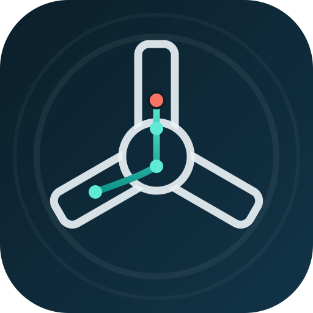
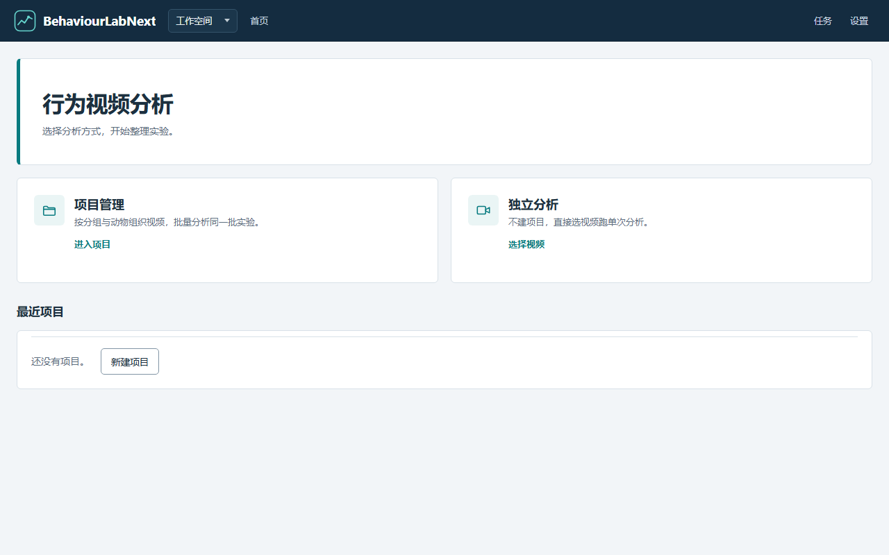
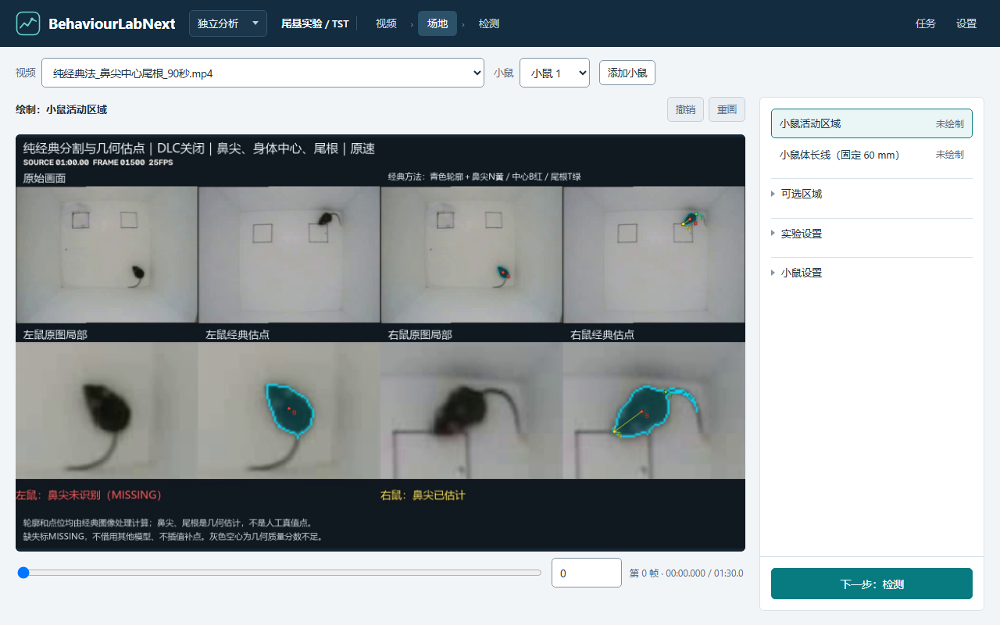
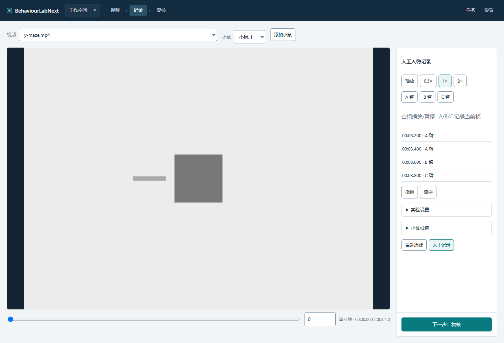
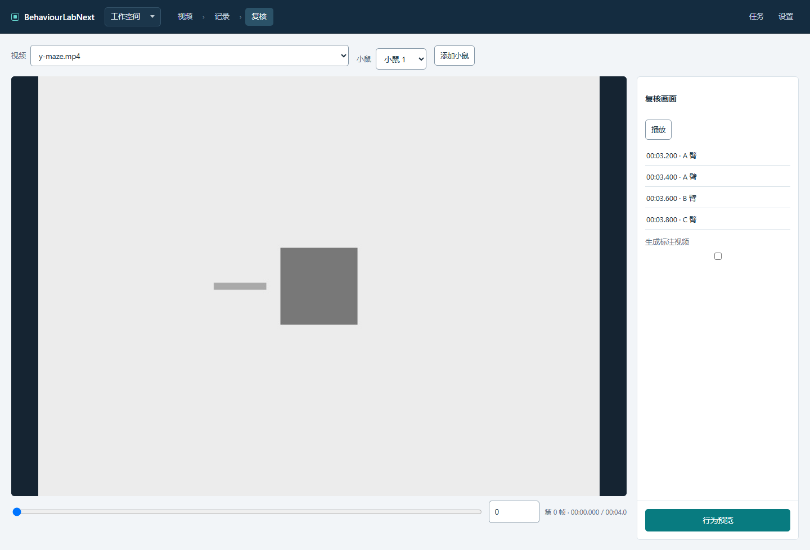
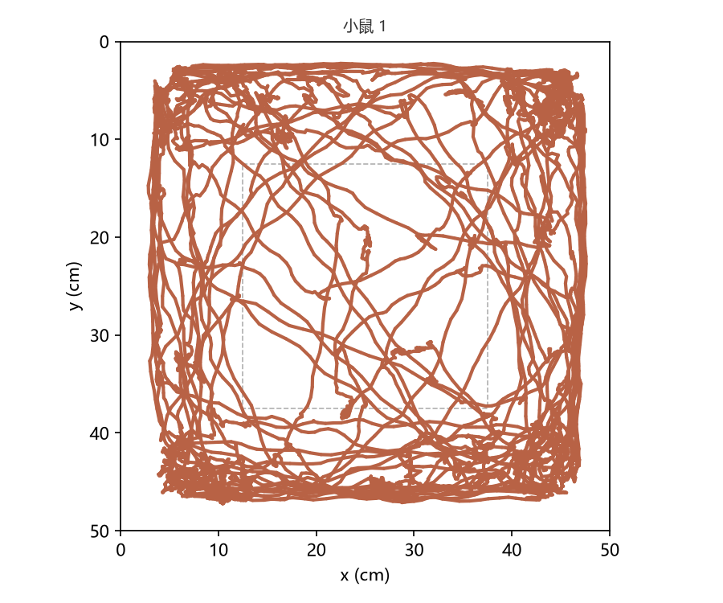
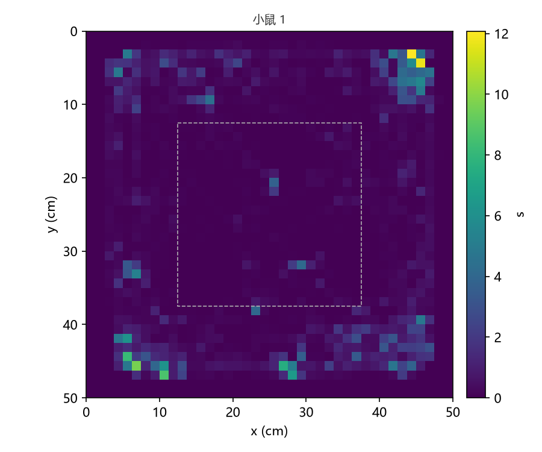
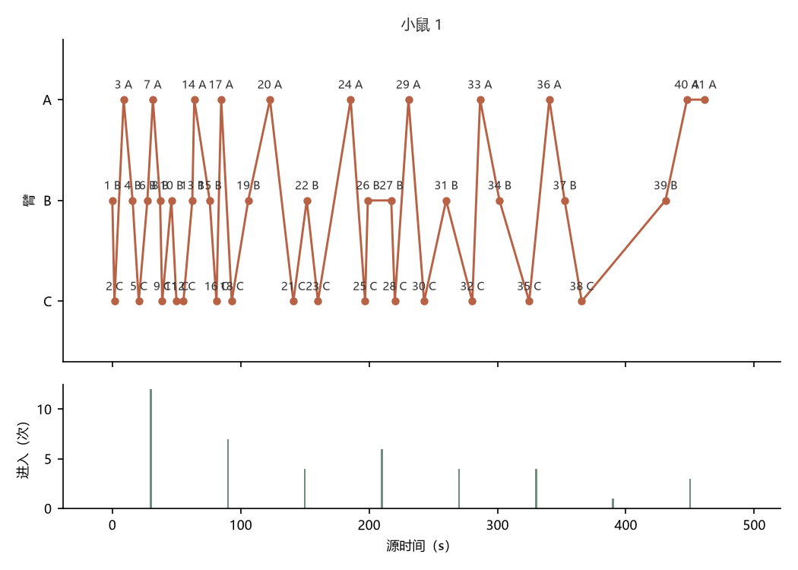

<div align="center">



# BehaviourLabNext

**Windows 本地经典视觉动物行为分析应用** · 无深度学习依赖 · 数据不出本机


</div>

本地服务与桌面窗口共用同一套服务与前端；正式桌面交付目标为 Windows 64 位 + CPython 3.11 + Microsoft Edge WebView2（系统级前提）。

> 📥 **下载**：最新版本 [v1.0.0 · Windows EXE](https://github.com/stors789/BehaviourLabNext/releases/latest)（解压即用，无需安装 Python）

## 界面预览

<p align="center">
  
  <br><sub>首页：项目管理 / 独立分析双入口</sub>
</p>

| 工作台 · 场地绘制 | Y 迷宫 · 人工记录 | Y 迷宫 · 记录复核 |
| --- | --- | --- |
|  |  |  |

## 功能一览

- **10 种经典范式**：旷场（OFT）、Y 迷宫（自发交替，按 IMPC 中心点入臂规则）、强迫游泳（FST）、尾悬（TST）、明暗箱（LDB）、高架十字迷宫（EPM）、高架零迷宫（EZM）、Morris 水迷宫（MWM）、Barnes 迷宫、新物体识别（NOR）。
- **自动检测 + 人工记录双路径**：Y 迷宫支持逐帧人工臂记录与复核；自动追踪按 IMPC 约定以小鼠中心点判定入臂。
- **可追溯计量**：每次 run 冻结配置，结果携带完整计量 metadata（分母定义、标定方式、规则口径），不把检测率混充准确率。
- **输出齐全**：观测/事件/分箱/汇总 CSV、轨迹图、热图、标注视频、ZIP 打包。
- **本地优先**：原始视频只读；数据根集中管理，同一数据根单实例排他锁。

## 如何用 WorkBuddy 3 天构建

本项目由人 + WorkBuddy（AI 编码代理）协作完成，从首个提交到 v1.0.0 发布用时 3 天：

> **110 个提交 · 约 6.8 万行代码 · 779 项 pytest 测试 + 21 个前端 DOM 测试 · 10 种实验范式**

- **约束先行**：[`AGENTS.md`](AGENTS.md) 固化工作方式——每次只做当前任务、不擅自扩展、缺失/未知/零值分开处理、不把检测率混充准确率、每块交付必须自检并留下证据。
- **分块推进**：开发拆成 26 个任务块，逐块执行"交付 → 验收 → 有限修正"循环；验收不过不进下一块，返修只动指定项。
- **分层的证据体系**：单元/数值测试、前端假 DOM 测试、构建验证 JSON、验收状态文档逐层对应——每个结论有证据支撑，未执行的如实标 `not_run`。

验收循环抓到过的真问题（举两个）：

1. **时序中位数背景吸收静止小鼠**：预览时前景偶尔变空。排查发现静止或小幅活动的小鼠会被中位数背景当成背景吸收。修正：正式分析改在钉住的 threshold 背景下重验，预览改用连续扫动的合成源保证可见性，并补了端到端回归。
2. **缺字段与非法值混为一谈**：一次返修把"未提供参数"与"显式非法参数"合并处理，导致缺必需参数时直接 KeyError。按验收恢复原校验合同：缺字段按缺失处理并给明确提示，非法值单独报错。

人的角色：**测试**（真实录像实跑 + 人工对照）、**提供想法**、**编写提示词**、**拍板设计**、**优化架构**；代理负责实现、测试与证据。

## 真实素材演示

| 旷场 · 轨迹 | 旷场 · 热图 | Y 迷宫 · 入臂序列 |
| --- | --- | --- |
|  |  |  |

真实用户录像实跑：Y 迷宫中心点规则自动入臂与人工对照相似率 92.68% / 95.24%（差异经核实为人工漏记）；旷场 10 分钟完整窗口检测率 95.7%–99.8%。逐 run 材料与统计见 [`docs/demo/`](docs/demo/README.md)。

## 环境与安装

- Python 3.11；依赖锁定见 `requirements.txt`，测试依赖见 `requirements-dev.txt`，构建工具见 `requirements-build.txt`。

```bash
python -m venv .venv
.venv\Scripts\python -m pip install -r requirements-dev.txt
```

## 启动（两个源码入口，同一主入口）

```bash
.venv\Scripts\python -m behaviourlab --data-dir "D:\BehaviourLabData"
.venv\Scripts\python launch.py --data-dir "D:\BehaviourLabData"
```

- 普通启动创建桌面窗口（需要 WebView2）；`--browser` 只运行同一服务等待用户中断。
- 未指定 `--port` 时自动申请空闲端口；服务只绑定 `127.0.0.1`。
- 未指定 `--data-dir` 时使用 `%LOCALAPPDATA%\BehaviourLabNext`；同一数据根同一时刻只允许一个实例（含排他锁）。
- `--behaviorlab-worker` 是冻结 EXE 的私有后台分派参数，不作为用户入口。

## 界面入口

首页选择**项目**（项目/组/动物上下文）或**独立分析**（项目外单次分析）。分析页顺序：选择视频 → 时间/方向/帧率 → 场地绘制或人工记录（依实验而定） → 检测设置与预览 → 开始分析；完成后从任务中心或项目页进入结果页，取回 CSV/PNG/MP4/ZIP。各实验的入口与人工路径差异见 [`docs/ARCHITECTURE.md`](docs/ARCHITECTURE.md)。

## 数据只读原则

原始视频文件只读；分析使用冻结配置写入数据根的 `runs/`、`tasks/`、`database/` 等专用目录。用户媒体、数据库、密钥与任务输出不进入版本库，也不进入构建包。

## 状态与验收

- **构建**：已实际完成一次 Windows EXE 构建（PyInstaller 6.22.3 / CPython 3.11.13，产物 `dist/windows/BehaviourLabNext/`，`--browser` 冒烟通过）；WebView2 桌面窗口等完整原生验收仍在进行。方法与边界见 [`docs/RUN_AND_BUILD.md`](docs/RUN_AND_BUILD.md)，逐项证据见 [`docs/BUILD_VALIDATION_STATUS.json`](docs/BUILD_VALIDATION_STATUS.json) 与 [`docs/ACCEPTANCE_STATUS.md`](docs/ACCEPTANCE_STATUS.md)。
- **独立动物精度**：无独立标注金标准；人工记录不代表更准确（标准可能漂移，有时漏和多），详见验收文档。

## 故障定位

- `logs/application.log`：服务运行日志。
- `logs/startup.log`：启动失败 cause/traceback（配 Windows 错误框）。
- `tasks/<job>/<run>/worker.log`：单个后台分析进程日志。

## 未来开发计划

- **MCP 接口**：提供 Model Context Protocol 服务端，让 AI Agent 直接对接本应用——
  查询项目/视频/run 的元数据与结果（summary.csv、events.csv、report.md），
  发起或查询分析任务、取回标注视频与图形输出；本地数据根仍然只读原则不变，
  Agent 经同一本地服务（127.0.0.1）访问，不引入云端依赖。
- **DeepLabCut 集成**：作为可选的深度学习检测后端（保留现有经典视觉管线为默认零依赖路径），
  并支持 DLC 标注数据格式的导入/导出，便于复用已有训练集与在本地继续训练。
- **多系统适配**：在 Windows 之外支持 macOS（含 Apple Silicon）与 Linux 桌面运行——
  服务端与 Web 前端本就平台无关，需要替换的是窗口层（WebView2 → WKWebView / WebKitGTK）
  与打包链（PyInstaller onefile/目录按平台出包）；数据根结构与实验算法不变。

## 许可证

本项目以 [GPL-3.0-or-later](LICENSE) 发布：你可以自由使用、修改与再分发，
修改后的版本同样须以 GPL-3.0 开源。
