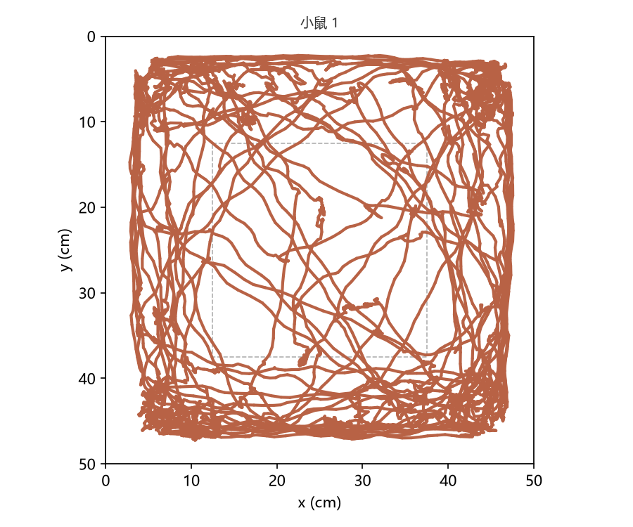
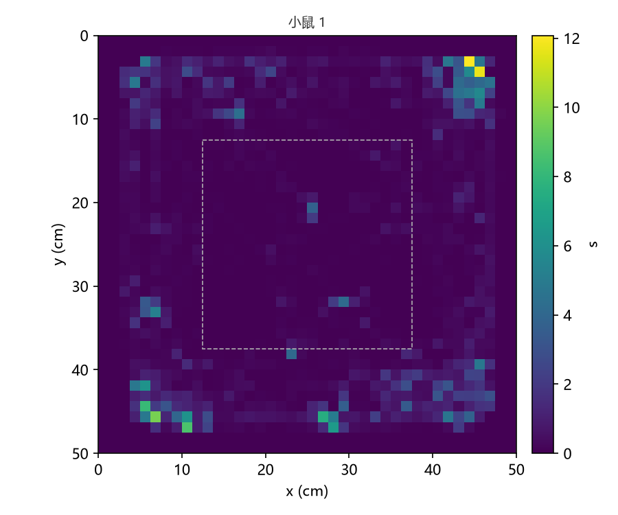
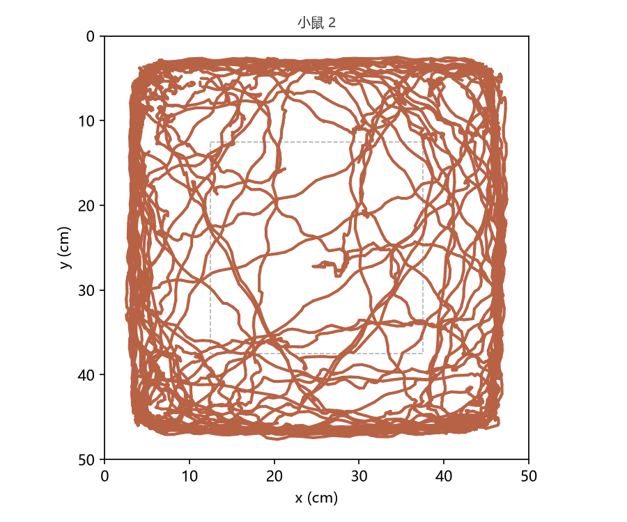
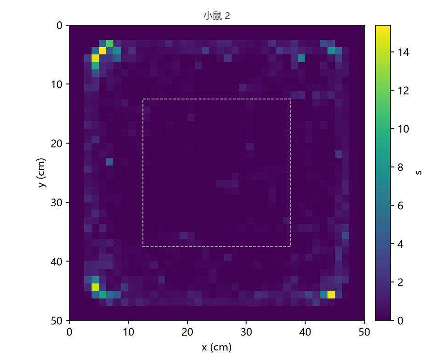

# 旷场实验 分析报告

- run: 26cce8d9c37bac435b03078b86972374
- job: f1b10f7d3fa03ac7b7f397daf58a7c29
- 源文件：旷场适应_2026-07-26_12-19-42.mpg（id 8628b6575f79a56d86d714ec108e481a）
- unit 数: 2

## 源时间与缺失

- 实际覆盖：start_s=0、end_s=600.1、duration_s=600.1、frame_count=15002
- 小鼠 1：窗口 0–600.1 s；检测率 99.83%
- 小鼠 2：窗口 0–600.1 s；检测率 98.89%

| 动物 | 中心区占比（%） | 场地内路程（cm） | 平均速度（cm/s） | 中心进入（次） |
| --- | --- | --- | --- | --- |
| 小鼠 1 | 6.878 | 4426 | 7.396 | 25 |
| 小鼠 2 | 5.736 | 4856 | 8.223 | 29 |

## 计量 metadata

- 全局：algorithm_version=0.1.0、coordinate_unit=cm
- ea661ef8847d6f4f91de04c72ee1dc15（ea661ef8847d6f4f91de04c72ee1dc15）：coordinate_unit=cm、mean_speed_denominator=completed motion duration inside the arena、occupancy_denominator=observed duration、outer_includes_wall=True、scale=four-corner perspective transform
- fb8096d1541bcc2c8336dddf2c827959（fb8096d1541bcc2c8336dddf2c827959）：coordinate_unit=cm、mean_speed_denominator=completed motion duration inside the arena、occupancy_denominator=observed duration、outer_includes_wall=True、scale=four-corner perspective transform

中心、外围、场外三类互斥；壁区包含在外围内。

## 图形

- 小鼠 1：轨迹图（unit_01_trajectory.png）、热图（unit_01_heatmap.png）、标注视频（annotated.mp4）
- 小鼠 2：轨迹图（unit_02_trajectory.png）、热图（unit_02_heatmap.png）、标注视频（annotated.mp4）

图片（与本报告同一目录）：

## 文件

- summary.csv
- unit_01_trajectory.png
- unit_01_heatmap.png
- unit_02_trajectory.png
- unit_02_heatmap.png
- report.md

完整 run 输出（observations.csv、results.json、annotated.mp4 等）在数据根 run 目录 26cce8d9c37bac435b03078b86972374。
