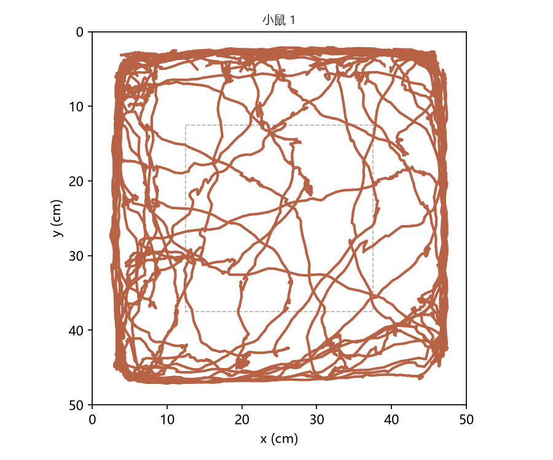
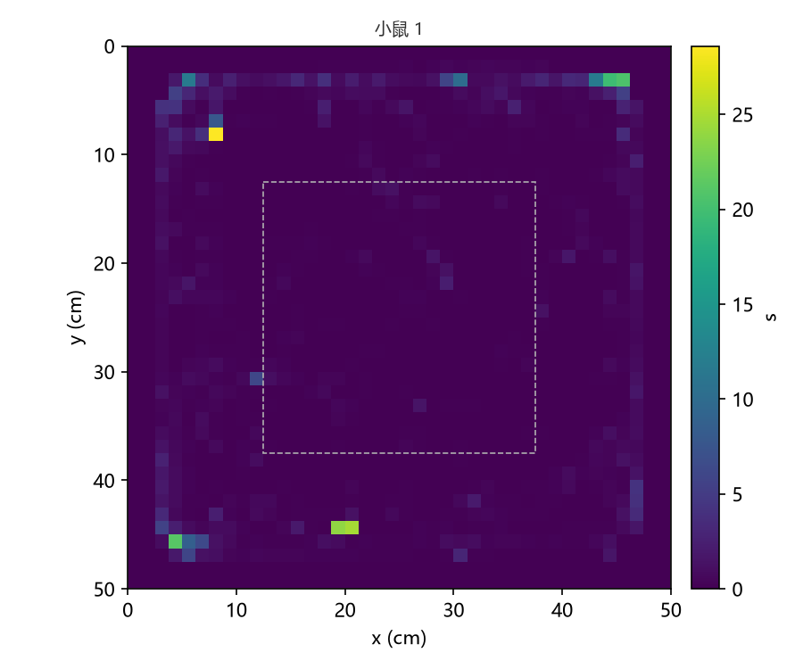
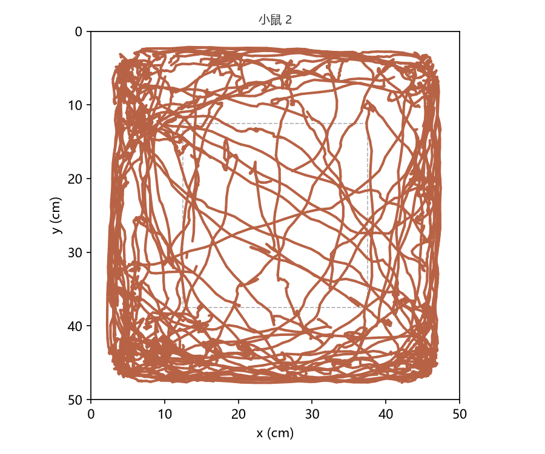
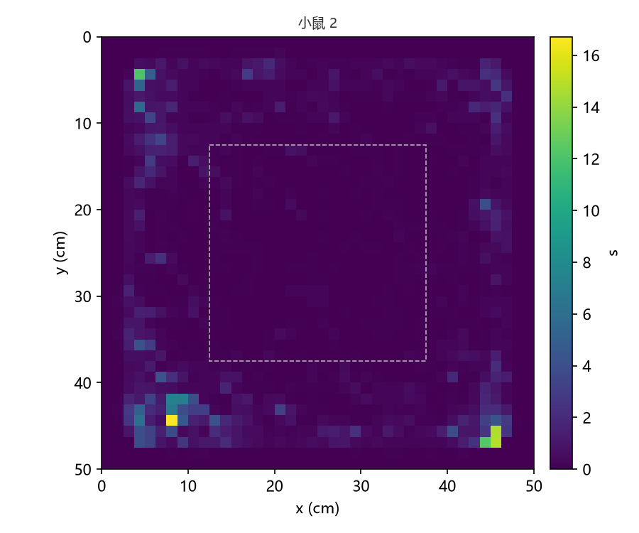

# 旷场实验 分析报告

- run: 8fd60da42cfdef986db4d2ea3530aa7b
- job: f1b10f7d3fa03ac7b7f397daf58a7c29
- 源文件：旷场适应_2026-07-26_11-35-37.mpg（id 8db7a2ec9c24826cecbcc035c70c81a1）
- unit 数: 2

## 源时间与缺失

- 实际覆盖：start_s=0、end_s=600、duration_s=600、frame_count=15001
- 小鼠 1：窗口 0–600 s；检测率 99.22%
- 小鼠 2：窗口 0–600 s；检测率 95.74%

| 动物 | 中心区占比（%） | 场地内路程（cm） | 平均速度（cm/s） | 中心进入（次） |
| --- | --- | --- | --- | --- |
| 小鼠 1 | 6.302 | 3647 | 6.139 | 21 |
| 小鼠 2 | 4.484 | 4753 | 8.38 | 29 |

## 计量 metadata

- 全局：algorithm_version=0.1.0、coordinate_unit=cm
- 972e0e98ca334aa2b15d1fe94be5a8fa（972e0e98ca334aa2b15d1fe94be5a8fa）：coordinate_unit=cm、mean_speed_denominator=completed motion duration inside the arena、occupancy_denominator=observed duration、outer_includes_wall=True、scale=four-corner perspective transform
- f5931e899c376b8a4ee84021f622b613（f5931e899c376b8a4ee84021f622b613）：coordinate_unit=cm、mean_speed_denominator=completed motion duration inside the arena、occupancy_denominator=observed duration、outer_includes_wall=True、scale=four-corner perspective transform

中心、外围、场外三类互斥；壁区包含在外围内。

## 图形

- 小鼠 1：轨迹图（unit_01_trajectory.png）、热图（unit_01_heatmap.png）、标注视频（annotated.mp4）
- 小鼠 2：轨迹图（unit_02_trajectory.png）、热图（unit_02_heatmap.png）、标注视频（annotated.mp4）

图片（与本报告同一目录）：

## 文件

- summary.csv
- unit_01_trajectory.png
- unit_01_heatmap.png
- unit_02_trajectory.png
- unit_02_heatmap.png
- report.md

完整 run 输出（observations.csv、results.json、annotated.mp4 等）在数据根 run 目录 8fd60da42cfdef986db4d2ea3530aa7b。
