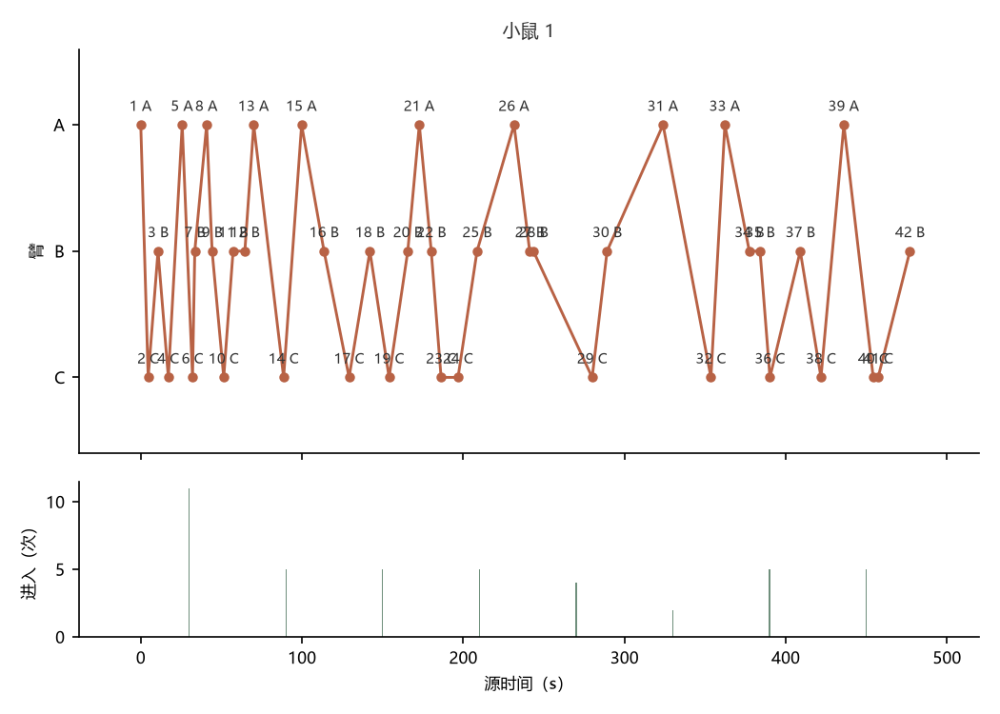
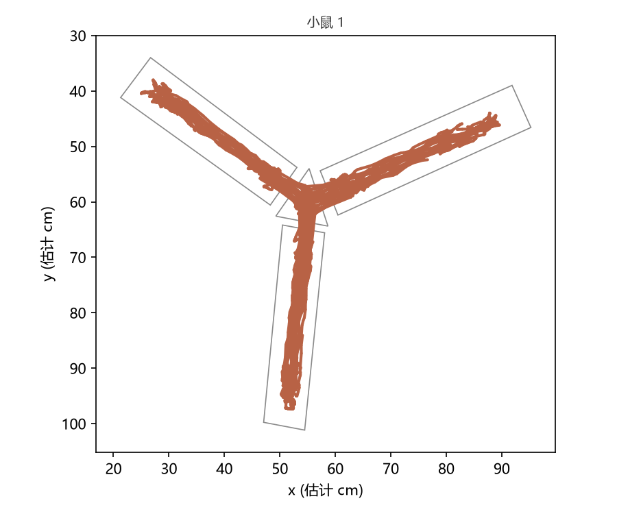
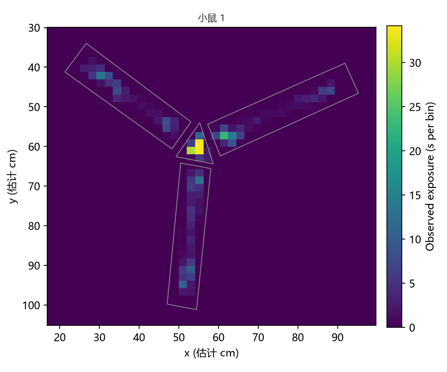
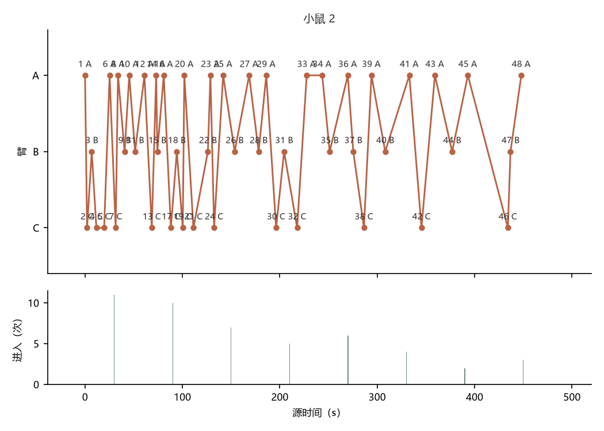
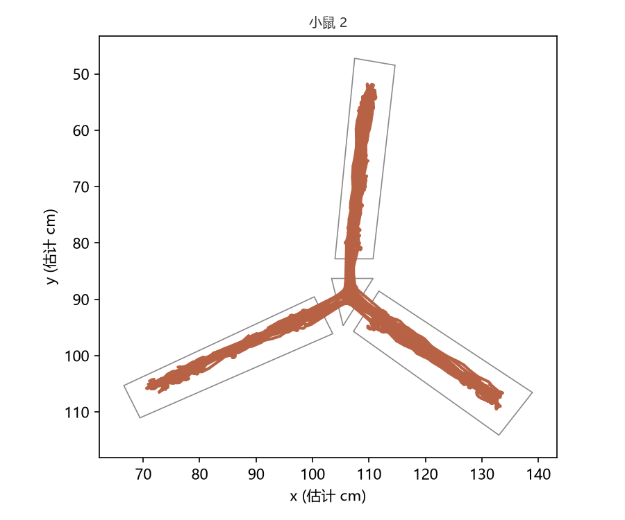
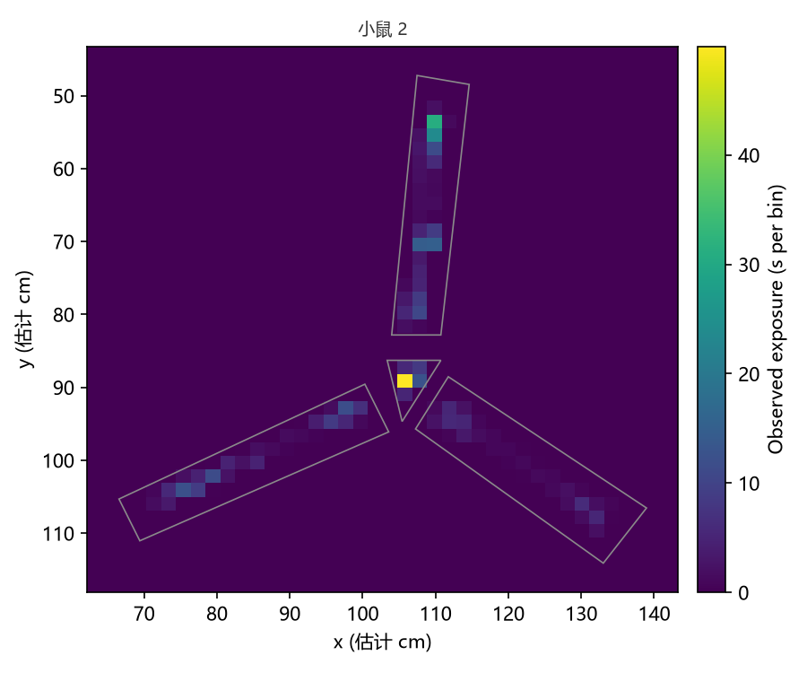

# Y 迷宫 分析报告

- run: 5ced5fdb978d7e4ede21cee5005875c0
- job: 365edca0560484fb2f4580a5ef95a2e2
- 源文件：视频2025-03-27 14.42.10.WMV（id d06c1aef604be1ff9bb5bf5fd57dc816）
- unit 数: 2

## 源时间与缺失

- 实际覆盖：start_s=0、end_s=481.1、duration_s=481.1、frame_count=9618
- 小鼠 1：窗口 0–481.1 s；检测率 97.58%
- 小鼠 2：窗口 0–481.1 s；检测率 90.87%

| 动物 | 总入臂次数 | 交替次数 | 交替机会数 | 自发交替率（%） | 中心区时间（s） |
| --- | --- | --- | --- | --- | --- |
| 小鼠 1 | 42 | 15 | 40 | 37.5 | 125.4 |
| 小鼠 2 | 48 | 22 | 46 | 47.83 | 81.8 |

## 计量 metadata

- 全局：algorithm_version=0.1.0、coordinate_unit=cm_estimated
- a1ef9fa7ced0f12cbecd515f21330d4c（a1ef9fa7ced0f12cbecd515f21330d4c）：alternation=entry index >= 3 with three distinct arms in the recent sequence、area_reference=median of the last 9 accepted areas and of the first 9 (fixed once full); both within [1/4, 4]、arm_entry_rule=center、arm_entry_rule_note=center-point rule: an entry is counted at the first valid observation whose body center is in a new region; entry depth, confirm time, center reset and require-center do not apply; missing/unknown observations are neutral; arm/center boundary flips count as observed (no debounce)、candidate_link=two accepted positions predict the next point; candidates beyond max_jump_cm are rejected and the nearest accepted、cm_per_px_est=0.2477、coordinate_unit=cm_estimated、missing_rule=missing exposure is counted as missing only and no held position is written; every association failure reports no_candidate_within_gate, the raw detector reason stays in the row field detection_reason、mode=automatic、scale=mean of 6 drawn-size ratios (arm length / projection span, arm width / drawn width); not a perspective correction、tracking_hold=short gaps keep association evidence only; after tracking_hold_s the link re-acquires by area
- c9638cd19c8fde4f1fefde1b1798f8a5（c9638cd19c8fde4f1fefde1b1798f8a5）：alternation=entry index >= 3 with three distinct arms in the recent sequence、area_reference=median of the last 9 accepted areas and of the first 9 (fixed once full); both within [1/4, 4]、arm_entry_rule=center、arm_entry_rule_note=center-point rule: an entry is counted at the first valid observation whose body center is in a new region; entry depth, confirm time, center reset and require-center do not apply; missing/unknown observations are neutral; arm/center boundary flips count as observed (no debounce)、candidate_link=two accepted positions predict the next point; candidates beyond max_jump_cm are rejected and the nearest accepted、cm_per_px_est=0.2534、coordinate_unit=cm_estimated、missing_rule=missing exposure is counted as missing only and no held position is written; every association failure reports no_candidate_within_gate, the raw detector reason stays in the row field detection_reason、mode=automatic、scale=mean of 6 drawn-size ratios (arm length / projection span, arm width / drawn width); not a perspective correction、tracking_hold=short gaps keep association evidence only; after tracking_hold_s the link re-acquires by area

## 警告

- 「小鼠 1」使用中心点入臂规则：臂/中心边界反复切换会按观测转换计数（无时间防抖）；入臂深度比例、入臂确认时间、中心区重置时间、再次入臂须经过中心区在本规则下不生效。
- 「小鼠 2」使用中心点入臂规则：臂/中心边界反复切换会按观测转换计数（无时间防抖）；入臂深度比例、入臂确认时间、中心区重置时间、再次入臂须经过中心区在本规则下不生效。
- 源FPS不可用，使用默认 20

## 图形

- 小鼠 1：入臂序列图（unit_01_sequence.png）、轨迹图（unit_01_trajectory.png）、热图（unit_01_heatmap.png）、标注视频（annotated.mp4）
- 小鼠 2：入臂序列图（unit_02_sequence.png）、轨迹图（unit_02_trajectory.png）、热图（unit_02_heatmap.png）、标注视频（annotated.mp4）

图片（与本报告同一目录）：

## 文件

- frozen_job.json
- observations.csv
- summary.csv
- events.csv
- bins.csv
- arm_entries.csv
- candidates.csv
- results.json
- unit_01_trajectory.png
- unit_01_heatmap.png
- unit_01_sequence.png
- unit_02_trajectory.png
- unit_02_heatmap.png
- unit_02_sequence.png
- annotated.mp4
- report.md
- result_manifest.json
